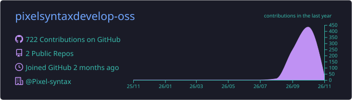
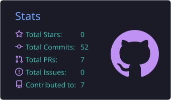
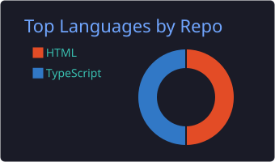

## 🙋‍♂️ About Me

- 👋 Hi, I'm **Ahmed Raza**, founder of **[Pixel Syntax](https://github.com/Pixel-syntax)**, a software studio in **Dubai, UAE**
- 🔭 I'm currently working on an **AI WhatsApp CRM** and a **delivery & fleet management ERP**
- 🤖 I'm currently building with **AI agents, Gemini AI and automation workflows**
- 🌱 I'm currently learning **Cloudflare Workers, edge computing and 3D/animation pipelines**
- 💬 Ask me about **CRMs, ERPs, React, Supabase and AI integrations**
- 📫 How to reach me: **info@pixelsyntax.store**
- ⚡ Fun fact: my software runs real businesses every day 🚚

## 🌐 Socials

## 💻 Tech Stack

## 📊 GitHub Stats

## 🐍 Contribution Snake

<picture>
  <source media="(prefers-color-scheme: dark)" srcset="https://raw.githubusercontent.com/pixelsyntaxdevelop-oss/pixelsyntaxdevelop-oss/output/github-snake-dark.svg"/>
  
</picture>

### 🚀 Have a project in mind? [Let's build it together →](https://pixelsyntax.store)

